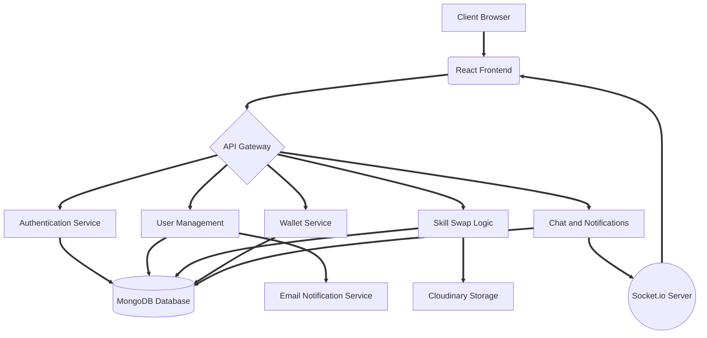
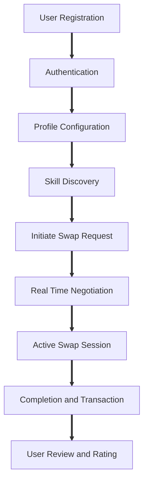

# SkillSwap Platform

SkillSwap is a comprehensive web application designed to facilitate the exchange of skills between users. The platform provides a robust environment for users to connect, communicate in real time, manage swap requests, and handle virtual wallet transactions.

## Table of Contents

* Project Overview
* System Architecture Diagram
* Application Workflow Diagram
* Technology Stack
* Prerequisites
* Installation and Setup
* Environment Configuration
* Development and Deployment
* License

## Project Overview

SkillSwap acts as a bridge for knowledge exchange. Users can offer their expertise in specific domains while simultaneously learning new skills from others. The platform features secure authentication, real time messaging, an integrated wallet system, and a dedicated admin dashboard for platform management.

## System Architecture Diagram

The following diagram illustrates the high level architecture of the SkillSwap platform, detailing the interactions between the frontend, backend, database, and external services.



## Application Workflow Diagram

The primary user journey follows a structured sequence:



1. **User Registration and Authentication:** Users sign up and securely log in using JWT based authentication.
2. **Profile Configuration:** Users set up their profiles, highlighting skills they offer and skills they wish to learn.
3. **Skill Discovery:** Users browse or search for potential swap partners based on skill compatibility.
4. **Swap Initiation:** A swap request is sent. Once accepted, a dedicated communication channel opens.
5. **Real Time Interaction:** Users negotiate and collaborate via the built in WebSocket chat interface.
6. **Transaction and Review:** Upon completion, wallet balances are updated if applicable, and users can leave reviews.

## Technology Stack

### Frontend Components
* React 19
* Vite Build Tool
* TailwindCSS for styling
* React Bootstrap
* Socket.io Client for real time features

### Backend Components
* Node.js and Express framework
* MongoDB with Mongoose ODM
* JSON Web Tokens for secure sessions
* Socket.io for WebSocket communication
* Cloudinary for media asset management

## Prerequisites

Ensure the following tools are installed on the local system prior to setup:

* Node.js version 14 or higher
* MongoDB server
* Git version control system

## Installation and Setup

1. **Clone the Repository**
   Download the source code to the local machine.

2. **Backend Initialization**
   Navigate to the backend directory and install required dependencies.
   ```bash
   cd backend
   npm install
   ```

3. **Frontend Initialization**
   Open a new terminal, navigate to the frontend directory, and install dependencies.
   ```bash
   cd frontend
   npm install
   ```

## Environment Configuration

Both frontend and backend require specific environment variables to function correctly.

### Backend Variables

Create an environment configuration file within the backend directory:

* PORT
* MONGODB_URI
* JWT_SECRET
* FRONTEND_URL
* CLOUDINARY configuration keys
* EMAIL service configuration keys

### Frontend Variables

Create an environment configuration file within the frontend directory if necessary, typically configuring the backend API URL.

## Development and Deployment

To run the application locally for development:

1. **Start Backend Server**
   ```bash
   cd backend
   npm run dev
   ```

2. **Start Frontend Server**
   ```bash
   cd frontend
   npm run dev
   ```

The frontend will typically be accessible at the Vite default port, and the backend will run on port 5000.

## License

This project is distributed under the MIT License.
